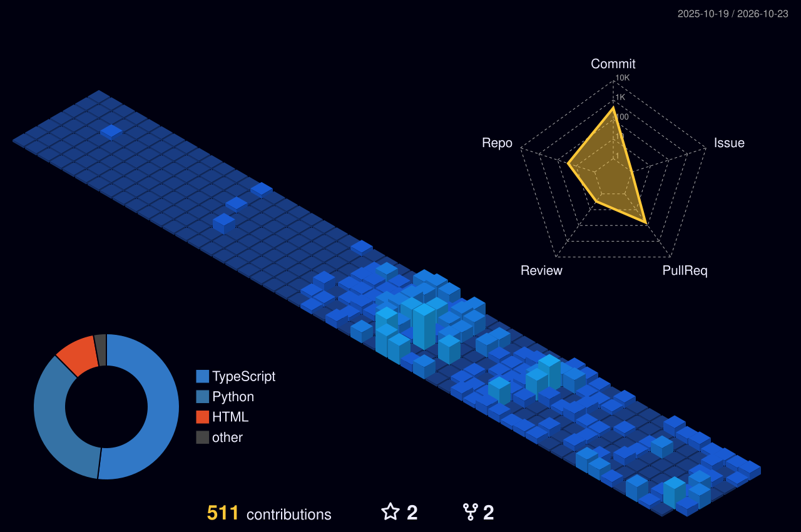

  <!-- ================= 1. HERO BANNER (AUTO DARK/LIGHT SWITCHING) ================= -->
  <picture>
    <source media="(prefers-color-scheme: dark)" srcset="banner.svg?v=1">
    <source media="(prefers-color-scheme: light)" srcset="banner-light.svg?v=1">
    
  </picture>

    

  <!-- ================= 2. WHAT I BUILD & LIFE BEYOND CODE ================= -->
  

    

  <!-- ================= 3. CAPABILITIES & TECH ORBIT ================= -->
  

    

  <!-- ================= 4. DEVELOPER ID & TELEMETRY DASHBOARD ================= -->
  

    

## 🚀 Featured Engineering & Builds

| Project / Curriculum | Core Capability & Architecture | Tech Stack | Link |
| :--- | :--- | :--- | :---: |
| [**MyAITesterBlueprint**](https://github.com/shivamnamdev/MyAITesterBlueprint) | Autonomous Agentic AI system for automated test scenario synthesis, DOM discovery, and quality validation. | `Python` `Agentic AI` `Playwright` `LLMs` | [**Explore Repo →**](https://github.com/shivamnamdev/MyAITesterBlueprint) |
| [**learn-python-step-by-step**](https://github.com/shivamnamdev/learn-python-step-by-step) | Practical, zero-fluff modular guide to mastering modern Python from fundamentals to production scripting. | `Python 3.12` `Automation` `Algorithms` | [**Explore Repo →**](https://github.com/shivamnamdev/learn-python-step-by-step) |

 

  <!-- ================= 5. 3D CONTRIBUTION CITY & SNAKE ================= -->
  <h2>🌃 My Contribution City</h2>
  
<em>Every commit builds another skyscraper — rebuilt automatically every day.</em>

  

    

  <picture>
    <source media="(prefers-color-scheme: dark)" srcset="https://raw.githubusercontent.com/shivamnamdev/shivamnamdev/output/github-contribution-grid-snake-dark.svg">
    <source media="(prefers-color-scheme: light)" srcset="https://raw.githubusercontent.com/shivamnamdev/shivamnamdev/output/github-contribution-grid-snake.svg">
    
  </picture>

    

  <!-- ================= 6. INTERACTIVE CONNECT FOOTER ================= -->
  

    

  <!-- Direct Clickable Social Badges -->
  

    
    &nbsp;&nbsp;
    
    &nbsp;&nbsp;
    
  

   

  <!-- Profile Views Counter Badge -->
  

    

  
<strong>Always learning, always building. ⚡</strong>

